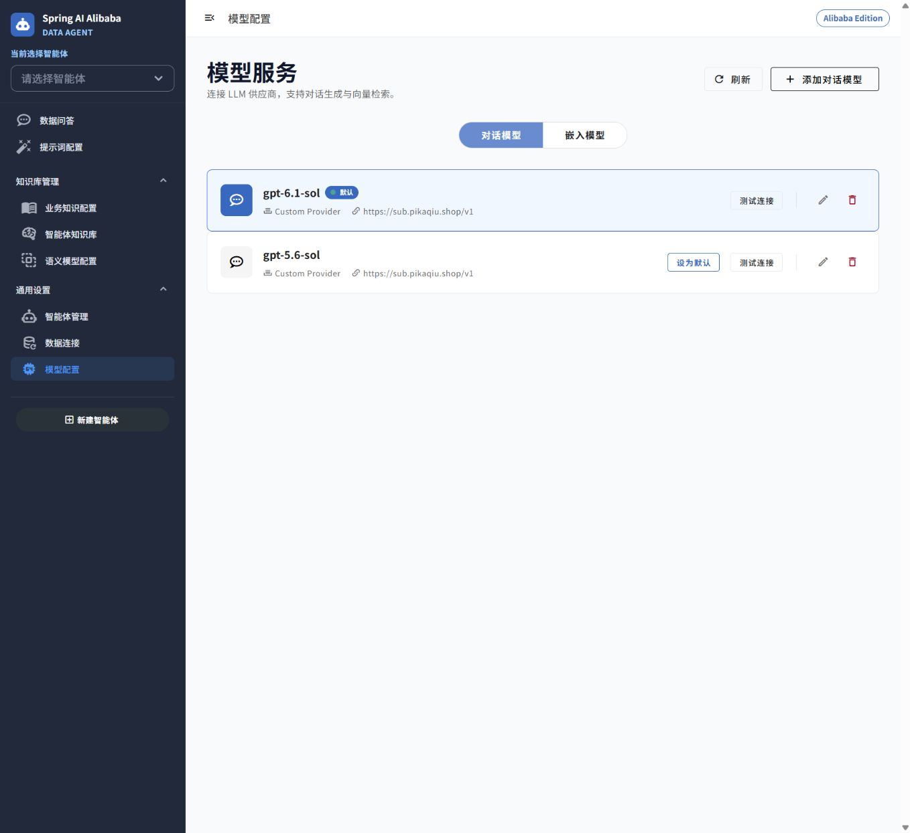

# Ticket 01 验收记录

日期：2026-11-14。代码起点 `9b130d3`；原工作区 Java 移动不纳入本票提交。

## 已验证

- Python 3.12.8，独立 MySQL 8.4 容器（本机 13306，数据库 dataagent_python），Java 服务未启动。GET /echo/ok 为 200 text/plain ok。
- HTTP 测试使用真实 MySQL 上随机新建、结束即删除的 schema；多次 lifespan 初始化和迁移可重复。测试覆盖配置重启可读、列表脱敏、掩码更新保留 key、聊天/embedding 真实 HTTP 适配、当前模型禁止删除、类型不允许更改、错误输出不泄密、并发激活只有一个同类型默认模型、URL 空用户名凭据拒绝、embedding 空间热切换禁止及维度检查。完整套件 10 项通过。
- 真实模型凭据按用户授权从 chatbi_mvp/.env 复制到 PYTHON/.env；聊天模型按用户指定使用 gpt-6.1-sol，embedding 为 BAAI/bge-m3。通过公开接口保存、test 发起供应商实际请求、activate 及 check-ready=true；重启 Uvicorn 后再次读取并测试两个模型成功。验收命令未输出密钥，env 已由 git check-ignore 确认忽略。
- 原 Nuxt 4 页面 /system/model-config 直接代理 Python 8065：读取两个类型、编辑保存聊天配置成功、创建临时配置成功、默认模型切换成功且最终恢复 gpt-6.1-sol、embedding 连接测试显示“连接测试成功！模型可用。”。临时配置由 HTTP 软删除清理；不把未观察到成功的页面删除对话框算作通过。删除业务效果由 HTTP 测试覆盖。
- Uvicorn 进程停止并重新启动（新 PID），刷新原管理页面，gpt-6.1-sol 仍为默认；原数据库配置、凭据与路径保持可调用。截图见下方。
- LangGraph 1.2.21 + langgraph-checkpoint 4.3.1 + langgraph-checkpoint-sqlite 3.1.3：真实本地 saver 在第一个独立 Python 进程写 interrupt，进程退出后第二个进程以同 thread_id 读状态并 Command(resume=True) 完成；仅验证所选 saver API/序列化兼容，不冒充 Ticket 03 的业务效果幂等验证。
- 98 路由契约、DTO 字段/初值/校验、各路由返回分支及前端服务链接已归档；13 张业务表的 MySQL/H2 DDL、实体和 Mapper、Python 内部表及 saver 分离盘点。公共恢复/鉴权/SSE/最终快照/配置指纹/CLI/删除闸门定义供后续 tickets 使用。

## 检查命令

在 PYTHON/ 执行：`uv run pytest`、`uv run mypy app tools`、`uv run ruff check app tests tools`、`uv run python tools/verify_saver.py`、`uv run python tools/build_baseline.py`。完整依赖锁见 uv.lock，运行方式见 README。

## 明确边界

01 不提供图执行、会话/审核 HTTP 扩展、业务查询、向量检索或恢复 CLI 的实现。当前前端全局加载 Agent 列表会收到 404，属于 Ticket 02；模型配置页面独立可用。Java 源码未改动或重启。全站鉴权、多 worker 和生产并发不在本票范围。其余票仍未开始；不因建立内部表而标记其业务实现完成。

页面删除成功提示未验收，删除效果已有 HTTP 验证；Java 框架表已按精确版本源码核对，见 python-framework-tables.md；转换/重建和部署现存数据由 16 实际核验。所有兼容性资料是源码提取与明确 Python 决策，不能替代其余 90 个原接口后续真实业务验收。

代码审查见 [双轴记录](python-ticket01-review.md)，两项发现均已修复并复核。
