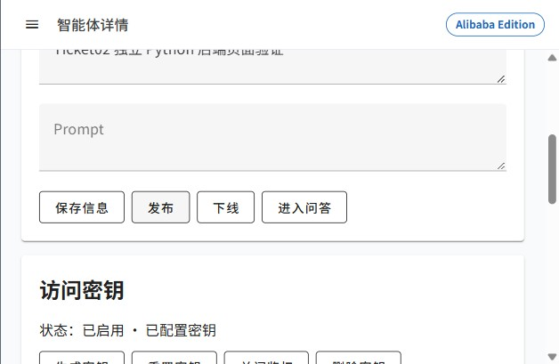

# Ticket 02 验收记录

日期：2026-11-14。固定起点 `e4eb1ec`。独立 Python 服务、MySQL 8.4（127.0.0.1:13306），Java 服务未启动。

## 范围与业务效果

已交付原接口编号 1、2、3、4、6–19、27–29、47–55，共 30 个原映射；新增 Python 凭据预检 `GET /api/agent/{id}/access`。Agent 列表/详情/创建/更新/发布/下线直接返回实体，预设问题返回数组及原消息对象，数据源实体/表名数组、字段及绑定接口保留各自响应形状。缺失实体 404，输入校验 400，业务拒绝沿用服务的 success=false 响应。

Agent 创建同时建立 OPEN 生命周期记录，所有本票 Agent 配置写入先锁 Agent 和生命周期行；后续运行创建/删除必须复用同一锁顺序。会话的生命周期及唯一占用表已在 002 建立，实际创建运行和删除互斥在 03/13 验证，不以建表冒充完成。

绑定写操作锁 Agent 并锁数据源，数据库唯一约束禁止重复绑定，同 Agent 并发绑定最终仅一个活动源。不存在的表拒绝且原选表不变；空选表允许保存但初始化拒绝。初始化持久化真实列名、类型、nullable 快照；不是成功占位或向量索引实现。数据源删除和解绑的外键级联覆盖选择表及快照。

## 已观察的页面操作

- 原 Nuxt 4 前端使用 NUXT_PUBLIC_BACKEND=python，后端独立运行。新建“Ticket02 页面验收”，列表可见，配置页更新描述、发布成功。管理列表新增“配置”入口，原占位详情页在 Python 模式展示完整配置。
- 从页面创建“Ticket02 MySQL”，连接独立 `dataagent_ticket02_demo`，只读用户实际测试连接，页面显示“连接成功”。Agent 页绑定该源、选择 sales、保存、初始化；HTTP 回读活动源及选表正确，管理库快照实际包含 id INTEGER 与 amount DECIMAL(12,2)。
- 页面下线后显示 offline，再发布恢复 published；重启刷新后两条预设问题仍在。配置页截图见下。
- 页面生成密钥，运行页手动输入后显示“凭据有效”；刷新后输入为空。没有将密钥放入 URL 或 localStorage/sessionStorage。密钥只读状态不显示完整值。
- 页面保存两条预设问题，问答页点击“销售总额是多少？”后输入框内容一致。点击仅填入，不执行尚未交付的查询。
- 后端进程停止重启（新 PID），页面刷新并用公开 HTTP 回读，Agent、数据源、两条预设问题、绑定、sales 选表及 schemaInitialized=true 均保留，真实 MySQL 连接再次测试成功；HTTP 测试同时覆盖多个应用生命周期下真实存储读取。

## 自动验证与边界

新增测试按既有确认的 HTTP seam 先失败后实现：Agent 生命周期/问题/重启、密钥脱敏/轮换/头优先级/关闭鉴权、独立真实 MySQL 元数据/选表/级联、错误凭据/不支持类型/并发绑定、自定义 URL 与嵌入凭据拒绝。每个测试使用真实 MySQL 随机 schema，查询测试额外创建独立业务库，结束后清理。供应商测试保持 Ticket 01 的外部 HTTP 边界。

Python 完整 pytest 15 项通过（46.95 秒）、mypy app tools、ruff check app tests tools 均通过；前端 vitest 6 文件、17 项通过。前端 nuxi typecheck 失败位置均在原有模型页、服务类型导入及其他原文件：model-config.vue 的 `.value`、services 下多个 `./common`/`./graph`/`./datasource` 导入、businessKnowledge 重复类型导出、datasourceSelection.test.ts 和 markdown highlight 类型；本票新增配置页、凭据组件及修改的前端文件未报告类型错误。此处保留失败状态，不宣称前端全量类型检查通过。

明确差异及 URL 参数限制见 PYTHON/README。新增 Python key 使用 SHA-256 摘要，旧 Java 编码数据转换仍属 16；PostgreSQL 连接 04、向量化 07、图/SSE 03/05/12、完整删除 13。原查询页会因这些未交付入口出现 404，本票没有挂假成功路由。

根目录 .gitignore 保留原规则并添加根缓存、浏览器验收输出；PYTHON 和前端的环境、数据、日志、node_modules 规则已检查。只暂存本票文件：原工作区 Java 移动的其余删除/新增保持原状。本票改动的前端文件位于 JAVA 下，因此以新路径加入提交，不顺带暂存原路径的用户删除。

